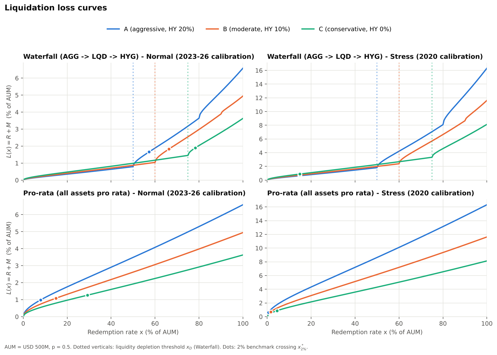
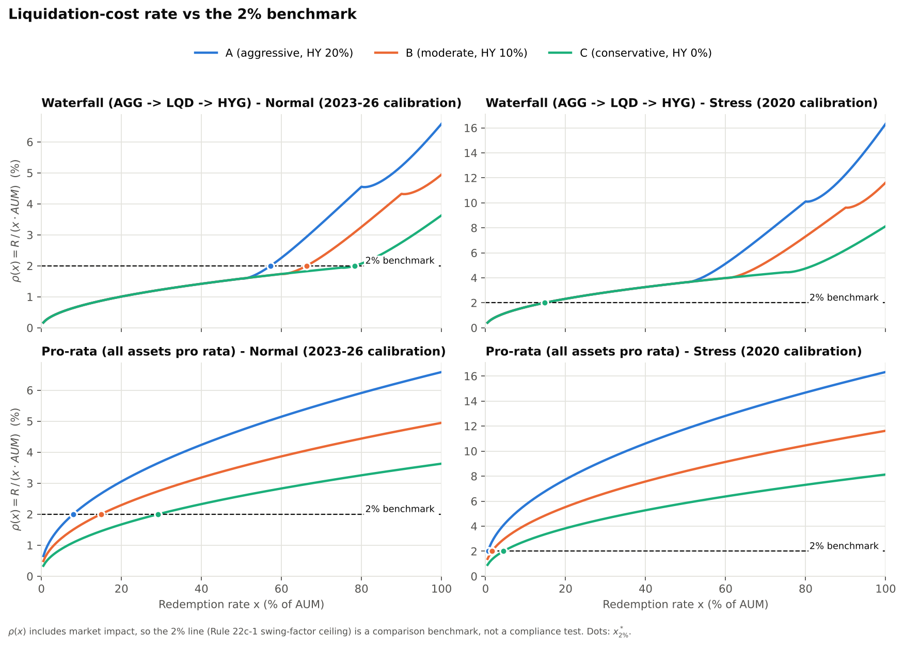
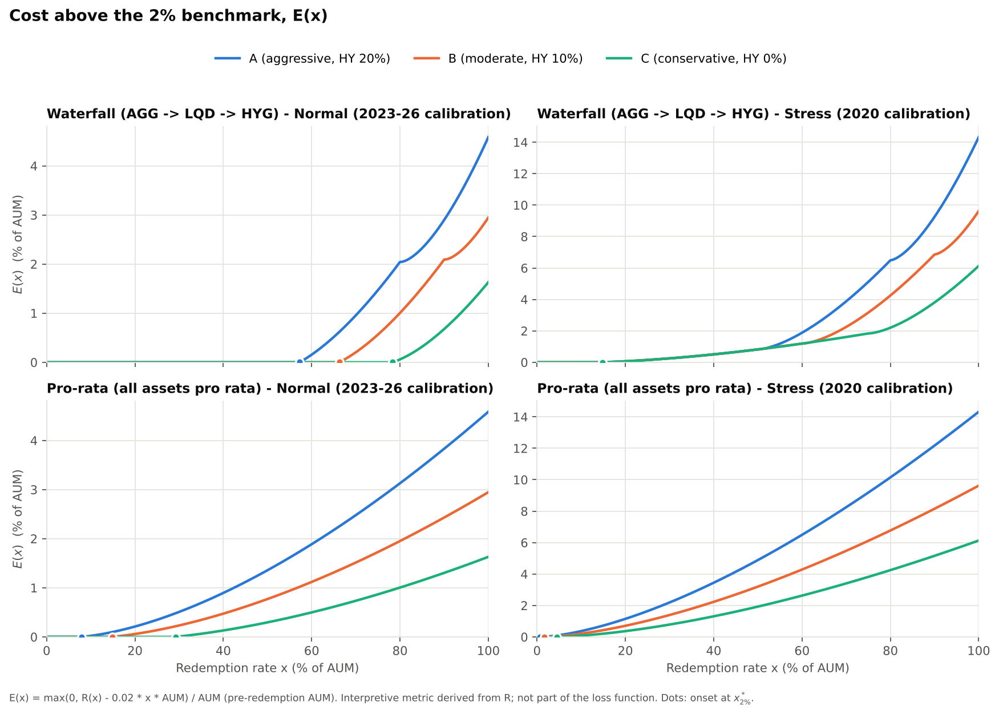
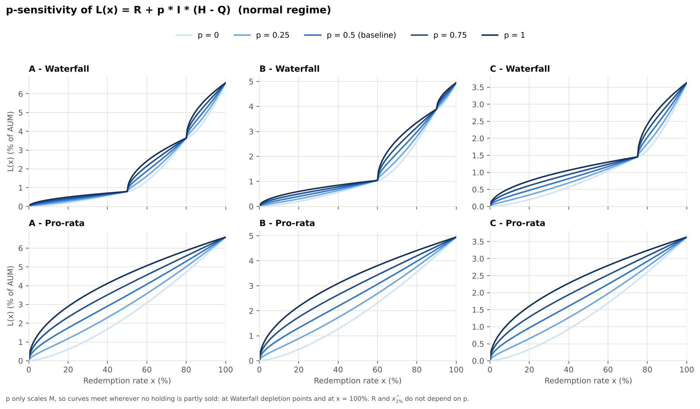
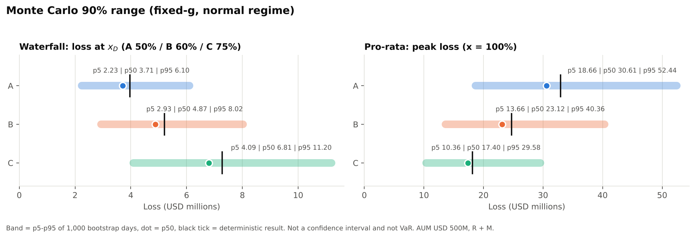

# Critical Redemption Rates in Open-End Bond Funds

**How large can a redemption wave get before liquidating a bond fund becomes expensive, and how much does the answer depend on *how* the fund sells?**

This repository contains a transparent, fully reproducible liquidation-cost model for a hypothetical USD 500M open-end bond fund. It compares two liquidation rules, **Waterfall** (sell the most liquid assets first) and **Pro-rata** (sell everything in proportion). For each rule it reports:

- the redemption rate at which the fund's liquid buffer runs out;
- the redemption rate at which liquidation costs exceed a 2% swing-cost benchmark taken from SEC Rule 22c-1.

> Research project by the Y-FoRM team (Yonsei Forum of Risk Management), 2026.
> Every number in this README is produced by the code in this repository (`code → outputs/tables → figures → README`).

---

## Key findings

All figures are at AUM = USD 500M and come from `outputs/tables/`.

1. **The liquidation rule matters more than anything else in the model.** For the same fund in the same market, Pro-rata reaches the 2% benchmark much earlier than Waterfall.
   - Normal market: Pro-rata at 7.95% / 14.90% / 29.20% redemption, Waterfall at 57.30% / 66.30% / 78.30% (portfolios A / B / C).
2. **Stress compresses everything.** Under 2020-calibrated stress inputs:
   - Waterfall crosses the benchmark at 14.80% for all three portfolios. At that point each portfolio is still selling only AGG, so the portfolio mix plays no role yet.
   - Pro-rata crosses at 0.65% / 1.60% / 4.50%.
3. **Waterfall delays costs; it does not remove them.** At 100% redemption both rules have sold everything and end with the same cost above the benchmark. Waterfall postpones the point where that cost appears, at the price of leaving remaining investors with a less liquid portfolio. The liquid buffer runs out at x_D = 50% / 60% / 75%.
4. **"Broad aggregate" is not "Treasury".** Built bottom-up from its components, AGG's price impact is 93.4% explained by its investment-grade corporate sleeve, even though Treasuries are ~47% of the fund.
5. **Fund size changes the threshold.** Impact grows with the square root of the dollar amount sold, so the same *percentage* redemption is costlier for a bigger fund.
   - At USD 1B, the Waterfall normal-market crossing is 39.85% for all three portfolios.
   - At USD 100M, portfolio C never reaches the benchmark in a normal market.
6. **Only the selling *order* matters, not the liquidity-weight values.** Changing the HQLA weights while keeping their order leaves every loss unchanged (USD 0 difference). Reversing the order raises portfolio A's loss by about USD 25.0M at 50% redemption.

These are **model-conditional** results. They inherit the literature-based price-impact and spread inputs (see [Limitations](#limitations)).

---

## 1. Research question and object

**Question.** As the redemption rate *x* rises, how do the liquidation rule (Waterfall vs Pro-rata) and the asset mix change:
- (a) the fund's liquidation loss;
- (b) the point where the liquid buffer is exhausted;
- (c) the point where the cost per redeemed dollar exceeds 2%?

**Research object: a hypothetical open-end (mutual) bond fund.** Investors redeem in cash at NAV, and the fund sells bonds when it needs to.
- The fund is **not** an ETF. ETF shares are mostly redeemed in kind through authorised participants, and Rule 22c-1 swing pricing does not apply to ETFs.
- The ETFs **AGG, LQD and HYG are used only as asset-class proxies:**

| Proxy | Asset class represented | Role |
|---|---|---|
| AGG | U.S. investment-grade *aggregate* bonds (≈47% Treasury, ≈23% agency MBS, ≈25% IG corporate, ≈6% other) | most liquid sleeve |
| LQD | U.S. investment-grade corporate bonds | intermediate |
| HYG | U.S. high-yield corporate bonds | least liquid |

Portfolios step the high-yield share down from the 20% cap common in "Core-Plus" bond funds to 0% ("Core"):

| Portfolio | AGG | LQD | HYG |
|---|---|---|---|
| A (aggressive) | 50% | 30% | 20% |
| B (moderate) | 60% | 30% | 10% |
| C (conservative) | 75% | 25% | 0% |

---

## 2. Methodology

### 2.1 Liquidation rules

A redemption of $x \cdot AUM$ is met by selling $Q_i(x)$ dollars of each asset $i$, where $H_i = w_i \cdot AUM$ is the holding.

- **Pro-rata:** $Q_i(x) = x \cdot H_i$. Every asset is sold in proportion and the portfolio mix is preserved.
- **Waterfall:** assets are sold completely, one after another, in liquidity order **AGG → LQD → HYG**, until the redemption is met.
  - The order follows the direction of the Basel III LCR HQLA hierarchy (Level 1 > Level 2A > non-HQLA). The weights used to rank the assets (0.90 / 0.65 / 0.35) are arbitrary.
  - Only their *order* enters the model, which `selling_order_check.csv` verifies.

### 2.2 Price impact and target-impact calibration

Square-root impact, calibrated so that selling $Q_{ref}$ = USD 1M moves the price by a literature target $T_i$:

```math
I_i(Q) = g_i\,\sigma_i\sqrt{\frac{Q}{ADV_i}}, \qquad
g_i = \frac{T_i}{\sigma_i\sqrt{Q_{ref}/ADV_i}}
\quad\Longrightarrow\quad
I_i(Q) = T_i\sqrt{\frac{Q}{Q_{ref}}}
```

Because $g_i$ is solved from $T_i$, the ETF volatility $\sigma_i$ and dollar volume $ADV_i$ **cancel** in every deterministic result. The deterministic results are driven by $T_i$, the spreads $s_i$, the weights and AUM. $\sigma$ and ADV enter only the Monte Carlo range (§2.7). This is a calibration, not a validation: the model reproduces $T_i$ by construction and cannot test it.

### 2.3 Loss decomposition

```math
R_i = \frac{s_i}{2}Q_i + I_i(Q_i)\,Q_i \qquad
M_i = p\cdot I_i(Q_i)\,(H_i - Q_i) \qquad
L(x) = \sum_i \big[R_i + M_i\big]
```

- **R:** realised cost on what is sold (half-spread plus execution impact).
- **M:** mark-down of what is *not* sold. Only the permanent share *p* of the impact is assumed to persist.
  - Baseline *p* = 0.5.
  - Because the evidence for *p* is weak, results are also shown for *p* ∈ {0, 0.25, 0.5, 0.75, 1}.
  - *p* changes M only, never R or the 2% crossing.

### 2.4 Critical metrics

The model reports two metrics. They answer different questions and are never combined.

| Metric | Definition | Defined for | Depends on |
|---|---|---|---|
| **Liquidity depletion threshold** $x_D$ | redemption rate at which the first (most liquid) asset is used up | Waterfall only | weights only (structural; no market data) |
| **2% benchmark crossing** $x^*_{2\%}$ | first $x$ (0.05 pp grid) with $\rho(x) \ge 2\%$ | Waterfall and Pro-rata | regime, inputs, AUM |

```math
\rho(x) = \frac{R(x)}{x\cdot AUM} \quad\text{(liquidation-cost rate per redeemed dollar)} \qquad
E(x) = \frac{\max\{0,\; R(x) - 0.02\,x\,AUM\}}{AUM}
```

$E(x)$, the *cost above the 2% benchmark*, is an interpretive metric derived from R. It is not part of the loss function.
- This study reads $E(x)$ as dilution borne by remaining investors.
- It is measured against **pre-redemption** AUM. The burden per remaining dollar is larger by a factor of $1/(1-x)$.

### 2.5 The 2% Rule 22c-1-inspired benchmark — what it is and is not

What Rule 22c-1 says:
- SEC Rule 22c-1(a)(3) lets eligible open-end funds use swing pricing. Swing pricing is **optional**, and money-market funds and ETFs are excluded.
- The swing factor is capped at **2% of NAV per share**.
- The swing factor may reflect spread costs, transaction fees and charges, and borrowing-related costs. **Market impact is excluded.**

How this study uses it:
- Our $R$ *includes* market impact.
- The 2% line is therefore used only as a **comparison benchmark** for $\rho(x)$. It is **not** a regulatory-compliance threshold, and $\rho(x)$ is not a regulatory swing factor.

### 2.6 Inputs

| Input | Normal | Stress | Source / construction |
|---|---|---|---|
| $T_{LQD}$ | 0.75% | 1.60% | Ellul, Jotikasthira & Lundblad (2011), §4.2 / Table 8: impact of 0.6–0.9% (2003–04) and 1.1–1.9% (2001–02) per USD 1M sold. Mapping 2003–04 to normal and 2001–02 to stress is the team's choice. |
| $T_{AGG}$ | 0.0996% | 0.2271% | **Bottom-up** from AGG's components (§2.6.1) |
| $T_{HYG}$ | 1.42% | 3.926% (range 3.025–4.828%) | Normal: 0.75% × √(36/10) = 0.75% × 1.897, using 2024 IG vs HY corporate-bond ADV (USD 36bn vs 10bn, Coalition Greenwich). Stress: 1.42% × linspace(2.13, 3.4, 5), the middle value as representative. |
| $s_{AGG}$ | 0.0244% | 0.0975% | Fleming (2003) quoted spread; stress = midpoint of 0.049–0.146% (Liberty Street Economics, 2020) |
| $s_{LQD}$ | 0.624% | 2.59% | Normal: Harris (2015) IG effective **half**-spread 31.2bp × 2. Stress: Kargar et al. (2021) risky-principal cost, already a full-spread equivalent. |
| $s_{HYG}$ | 1.014% | 3.83% | Normal: Harris (2015) non-IG half-spread 50.7bp × 2. Stress: median of 1.014% × [3.4, 4.15]. |
| *p* | 0.5 | 0.5 | Almgren, Thum, Hauptmann & Li (2005) ≈1:1 permanent/temporary split (equity evidence) |
| AUM | USD 500M | | sensitivity: USD 100M, USD 1B |

**Correction note.** An earlier internal version doubled the Kargar et al. stress figure a second time, giving LQD 5.18% and HYG 5.935%. Kargar's measure, $2Q(P_{trade}-P_{ref})/P_{ref}$, already contains the factor 2. The corrected values above are used everywhere in this repository. Normal-market results and $x_D$ were unaffected.

#### 2.6.1 AGG bottom-up target impact

Selling AGG pro rata sells $w_k Q$ of each component *k*. Under the same square-root law:

```math
\sum_k T_k\,(w_kQ)\sqrt{\tfrac{w_kQ}{Q_{ref}}} = \Big(\sum_k w_k^{3/2}T_k\Big)\,Q\sqrt{\tfrac{Q}{Q_{ref}}}
\quad\Longrightarrow\quad
T_{AGG} = \sum_k w_k^{3/2}\,T_k
```

Assumptions behind this formula:
- components are sold pro rata at the same time;
- component impacts are independent of each other;
- spreads are handled separately.

The component inputs are:
- **Treasury-like** (Treasury, sovereign, supranational): 0.00078%;
- **Agency MBS:** 0.0375%, half of a 5–10bp TBA spread used as a proxy;
- **Corporate-like** (IG corporate, CMBS, local authority, residual): 0.75%, the same Ellul value as LQD;
- **Cash:** 0.

Stress inputs:
- Treasury-like and MBS: × 5.5, the Treasury multiple (Fleming & Ruela, 2020).
- Corporate-like: 1.6%.

`src/crr/agg_target.py` re-derives the adopted constants.

### 2.7 Uncertainty: two separate ranges, never combined

- **Monte Carlo 90% range (fixed-g, normal regime).**
  - $g_i$ is held at its normal-regime calibration.
  - 1,000 trading days are bootstrapped from the normal window (2023-01-03 to 2026-09-30, 939 days). The same day is used for all assets.
  - The cancellation therefore breaks: $I_{i,d}(Q) = T_i\,(\sigma_{i,d}/\bar\sigma_i)\sqrt{\overline{ADV}_i/ADV_{i,d}}\,\sqrt{Q/Q_{ref}}$.
  - The p5–p95 of the loss is reported.
  - It is **not a confidence interval**: the deterministic result has no data-estimation error, and the p50 sits below it.
  - It is **not VaR**: no returns or horizon are simulated.
  - It covers the normal regime only and is conditional on $T_i$.
- **Stress-assumption range.** Stress losses are recomputed for each of the five HYG (and AGG) stress targets, one at a time. AGG's five slots hold a single bottom-up point estimate, so only HYG adds width. Waterfall at $x_D$ sells no HYG, so its range collapses to a point.

### 2.8 Market regimes

Two regimes are modelled:
- **Normal:** 2023-01-03 to 2026-09-30.
- **Stress:** 2020-02-03 to 2020-04-30 (COVID-19).

In each regime, $\sigma$ and ADV come from 20-day rolling windows of the ETF data. Normal uses the window mean. Stress uses the single trading day whose combined volatility/volume illiquidity rank is closest to the 90th percentile, which keeps $\sigma$ and ADV from the same day.

The stress regime differs from normal mainly through the **stress $T_i$ and $s_i$ inputs**. The chosen stress days (AGG 2020-04-29, HYG 2020-04-13, LQD 2020-04-08) fall after the Fed's March 2020 interventions, but they do not affect deterministic results.

---

## 3. Results

<!-- RESULTS:START -->
#### Model inputs (per asset)

| Asset | T normal | T stress | s normal | s stress |
|---|---|---|---|---|
| AGG | 0.0996% | 0.2271% | 0.0244% | 0.0975% |
| LQD | 0.7500% | 1.6000% | 0.6240% | 2.5900% |
| HYG | 1.4200% | 3.9260% | 1.0140% | 3.8300% |


#### AGG bottom-up target impact (share of T_AGG by sleeve)

| Sleeve | Weight | Share of T_AGG (normal) | Share of T_AGG (stress) |
|---|---|---|---|
| Treasury | 46.65% | 0.2% | 0.6% |
| Agency MBS | 22.81% | 4.1% | 9.9% |
| IG Corporate | 24.88% | 93.4% | 87.4% |
| Other | 5.60% | 2.2% | 2.1% |
| **T_AGG (derived / adopted)** |  | 0.0996% / 0.0996% | 0.2271% / 0.2271% |


*The listed 'Other' sub-items sum to 5.60%, not the reported 5.66% (see Limitations).*


#### Critical metrics (AUM = USD 500M)

| Portfolio | x_D (Waterfall) | x*₂% Waterfall, normal | x*₂% Waterfall, stress | x*₂% Pro-rata, normal | x*₂% Pro-rata, stress |
|---|---|---|---|---|---|
| A | 50.0% | 57.30% | 14.80% | 7.95% | 0.65% |
| B | 60.0% | 66.30% | 14.80% | 14.90% | 1.60% |
| C | 75.0% | 78.30% | 14.80% | 29.20% | 4.50% |


#### Waterfall vs Pro-rata gap in x*₂%

| Portfolio | Regime | Waterfall − Pro-rata | Waterfall ÷ Pro-rata |
|---|---|---|---|
| A | normal | 49.35 pp | 7.2× |
| B | normal | 51.40 pp | 4.4× |
| C | normal | 49.10 pp | 2.7× |
| A | stress | 14.15 pp | 22.8× |
| B | stress | 13.20 pp | 9.2× |
| C | stress | 10.30 pp | 3.3× |


#### Losses, Monte Carlo 90% range and stress-assumption range (USD millions, R + M, AUM = USD 500M)

| Portfolio | Waterfall L at x_D (normal) | Waterfall MC 90% range | Pro-rata peak L (normal) | Pro-rata MC 90% range | Waterfall stress-assumption range | Pro-rata stress-assumption range |
|---|---|---|---|---|---|---|
| A | 3.97 (x=50%) | 2.23 – 6.10 (p50 3.71) | 32.92 (x=100%) | 18.66 – 52.44 (p50 30.61) | 9.10 – 9.10 | 72.60 – 90.63 |
| B | 5.21 (x=60%) | 2.93 – 8.02 (p50 4.87) | 24.73 (x=100%) | 13.66 – 40.36 (p50 23.12) | 11.95 – 11.95 | 54.94 – 61.31 |
| C | 7.28 (x=75%) | 4.09 – 11.20 (p50 6.81) | 18.15 (x=100%) | 10.36 – 29.58 (p50 17.40) | 16.67 – 16.67 | 40.65 – 40.65 |


#### Cost above the 2% benchmark at full redemption, E(100%)

| Portfolio | Normal | Stress |
|---|---|---|
| A | 4.58% | 14.32% |
| B | 2.95% | 9.62% |
| C | 1.63% | 6.13% |


*Identical for Waterfall and Pro-rata: at x = 100% both sell every holding.*


#### AUM sensitivity of x*₂% (AUM in USD; W = Waterfall, PR = Pro-rata; — = never reaches 2%)

| Portfolio | Regime | 100M W | 100M PR | 500M W | 500M PR | 1B W | 1B PR |
|---|---|---|---|---|---|---|---|
| A | normal | 78.10% | 39.75% | 57.30% | 7.95% | 39.85% | 4.00% |
| A | stress | 55.65% | 3.05% | 14.80% | 0.65% | 7.40% | 0.35% |
| B | normal | 91.55% | 74.35% | 66.30% | 14.90% | 39.85% | 7.45% |
| B | stress | 64.40% | 8.00% | 14.80% | 1.60% | 7.40% | 0.80% |
| C | normal | — | — | 78.30% | 29.20% | 39.85% | 14.60% |
| C | stress | 73.85% | 22.30% | 14.80% | 4.50% | 7.40% | 2.25% |


#### Selling-order check (Waterfall, normal regime; largest absolute change in L(x) vs the baseline order)

| Portfolio | Same order, different magnitudes (0.51/0.50/0.49, 0.99/0.02/0.01) | Reversed order HYG -> LQD -> AGG |
|---|---|---|
| A | USD 0 | USD 24,985,844 (at x = 50.0%) |
| B | USD 0 | USD 16,400,765 (at x = 48.5%) |
| C | USD 0 | USD 8,747,574 (at x = 40.5%) |
<!-- RESULTS:END -->

### Figures

| | |
|---|---|
|  |  |
| **Fig. 1** Loss L(x) = R + M. Dotted lines mark $x_D$; dots mark $x^*_{2\%}$. | **Fig. 2** Liquidation-cost rate ρ(x) against the 2% benchmark. |
|  |  |
| **Fig. 3** Cost above the benchmark, E(x). | **Fig. 4** p-sensitivity (normal regime). |


**Fig. 5** Monte Carlo 90% range. It is neither a confidence interval nor VaR.

### How to read the results

- **x_D is structural; x\*₂% is market-dependent.** In a normal market, the Waterfall crossing sits just beyond x_D (57.30% vs 50%, for example): once AGG is exhausted, the costlier LQD/HYG sales push ρ(x) over 2%. In stress, AGG alone breaches 2% at 14.80%, well before x_D.
- **Absolute gap vs relative gap.** The gap measured in percentage points shrinks in stress (from about 49–51 pp to 10–14 pp). Measured as a multiple, it widens (portfolio A: 7.2× → 22.8×). Which measure is used changes the conclusion.
- **Waterfall beating Pro-rata is partly by design.** The assumed selling order (AGG → LQD → HYG) matches the order of the input costs ($T$ and $s$). Waterfall therefore *must* be cheaper at every *x*; this is a merit-order consequence, not an independent finding. The informative outputs are *how much* cheaper, *where* the thresholds sit, and what illiquidity the remaining investors are left holding.
- **The trade-off.** Pro-rata spreads costs evenly across investors over time. Waterfall's lower early costs last only while the liquid buffer lasts.

---

## 4. Limitations

The results are **conditional on literature-based inputs and model assumptions.**

**Inputs and proxies**
- ETF volatility and volume do not measure the liquidity of the underlying bonds. They are used only for the Monte Carlo range.
- **$T_i$ and $s_i$ come from the literature and are not validated inside the model.**
  - Scaling every normal $T_i$ by 0.5×–2× moves losses roughly proportionally and moves the 2% crossings substantially (supplementary table in `outputs/results_summary.md`).
  - Portfolio rankings and $x_D$ are unchanged under that scaling.
- **Ellul et al. (2011):** the stress value 1.6% lies inside the reported 1.1–1.9% range, but the exact point estimate is not confirmed. Labelling the paper's periods "normal" and "stress" is the team's mapping.
- **Spreads:**
  - Harris (2015) values are size and rating *bucket* proxies, not estimates for the LQD/HYG holdings.
  - Different spread sources measure different cost concepts: quoted spread, effective spread, and risky-principal cost.
- **AGG components:**
  - The MBS impact uses a half-spread proxy, and the MBS stress multiple borrows the Treasury multiple.
  - The AGG corporate sleeve reuses LQD's Ellul coefficient, so diversification between AGG and LQD may be overstated.
  - **Data issue:** the iShares "Other" sub-items sum to 5.60%, not the reported 5.66%. If the 0.06 pp gap belongs to a corporate-like item, $T_{AGG}$ rounds to 0.0997%.
- **HYG:** HYG's normal target is scaled from LQD by market-wide ADV, and its stress multiple is bracketed between two competing values. No HY-specific stress multiple was found.

**Impact model**
- The square-root form is taken mainly from equity-market evidence; Almgren et al. (2005) estimate a temporary-impact exponent of about 0.6. Calibrating at USD 1M and extrapolating to hundreds of millions understates impact if the true exponent is above 0.5.
- The model is single-period and deterministic. It has no price recovery, no cross-asset impact and no redemption → NAV → redemption feedback.

**Loss measurement**
- $M$ depends on the persistence assumption $p$, for which the bond evidence points both ways; *p* is therefore shown from 0 to 1.
- Execution impact and persistent impact share the same $I_i$, because separate calibration data are not available.

**Thresholds**
- Waterfall assumes the fund always sells the most liquid asset first.
- The 2% line is a benchmark, not a compliance test.
- $E(x)$ uses pre-redemption AUM, which understates the burden per remaining dollar by $1/(1-x)$.
- All thresholds depend on fund size and are reported at USD 500M unless stated.

**Uncertainty**
- The Monte Carlo range covers only normal-regime $\sigma$/ADV variation and is conditional on $T_i$.
- Over the evaluated Waterfall range it reflects AGG alone.
- The stress-assumption range varies only HYG in practice.

**Possible extensions**
- validation on fund-flow and transaction data;
- alternative impact exponents and functional forms;
- order-reversal stress tests, for example margin-call-driven sales of the "liquid" sleeve;
- a remaining-NAV denominator for $E(x)$;
- a multi-period model with stochastic rates, spreads and liquidity.

---

## 5. Repository structure

```
critical-redemption-rates/
├── README.md
├── requirements.txt
├── Makefile                      # make all  -> run model, figures, summary, tests
├── src/crr/
│   ├── config.py                 # every assumption, with its source and units
│   ├── model.py                  # liquidation rules, impact, R/M/L, x_D, x*_2%, E(x)
│   ├── uncertainty.py            # Monte Carlo 90% range, stress-assumption range
│   └── agg_target.py             # bottom-up derivation of T_AGG
├── scripts/
│   ├── run_model.py              # -> outputs/tables/*.csv
│   ├── make_figures.py           # -> outputs/figures/*.png
│   ├── make_summary.py           # -> outputs/results_summary.md (+ README results block)
│   └── fetch_data.py             # optional: rebuild the ETF metrics from Yahoo Finance
├── data/
│   ├── liquidity_metrics_normal.csv
│   └── liquidity_metrics_stress_2020.csv
├── outputs/
│   ├── tables/                   # every number in this README
│   ├── figures/
│   └── results_summary.md
├── docs/
│   └── CHANGELOG.md              # methodology changes and corrections
└── tests/test_model.py           # reference values, invariants, README sync
```

## 6. How to run

Requires Python ≥ 3.10.

```bash
git clone <this-repo-url>
cd critical-redemption-rates
python -m venv .venv && source .venv/bin/activate     # Windows: .venv\Scripts\activate
pip install -r requirements.txt

python scripts/run_model.py      # model -> outputs/tables/   (≈5 s)
python scripts/make_figures.py   # tables -> outputs/figures/
python scripts/make_summary.py   # tables -> outputs/results_summary.md
python -m pytest -q              # reference values, invariants, README sync
# or simply:  make all
```

The shipped data snapshot reproduces every published number exactly. `scripts/fetch_data.py` (needs `pip install yfinance`) rebuilds the ETF metrics into a separate folder. Yahoo Finance revises its history, so a re-download may change the Monte Carlo range slightly; deterministic results do not change, because $\sigma$ and ADV cancel.

## 7. Data

`data/` contains only **derived** daily measures for AGG, LQD and HYG, computed from Yahoo Finance data downloaded on 2026-10-03. Raw prices are not included.

| File | Window | Trading days |
|---|---|---|
| `liquidity_metrics_normal.csv` | 2023-01-03 to 2026-09-30 | 939 |
| `liquidity_metrics_stress_2020.csv` | 2020-02-03 to 2020-04-30 | 62 |

| Column | Definition | Used by the model? |
|---|---|---|
| `ADV_20d_usd` | 20-day mean of close × volume (USD) | g calibration (cancels) and Monte Carlo range |
| `Volatility_ann` | 20-day std of daily returns × √252 | g calibration (cancels) and Monte Carlo range |
| `CS_Spread_est_REFERENCE_ONLY` | Corwin–Schultz (2012) spread of the ETF wrapper | No, diagnostic only |

## 8. References

- Almgren, R., Thum, C., Hauptmann, E., & Li, H. (2005). Direct estimation of equity market impact. *Risk*, 18(7).
- Basel Committee on Banking Supervision (2013). *Basel III: The Liquidity Coverage Ratio and liquidity risk monitoring tools.*
- Bouveret, A., & Yu, J. (2021). *Risks and vulnerabilities in the U.S. bond mutual fund industry.* IMF Working Paper WP/21/109.
- Corwin, S. A., & Schultz, P. (2012). A simple way to estimate bid-ask spreads from daily high and low prices. *Journal of Finance*, 67(2).
- Ellul, A., Jotikasthira, C., & Lundblad, C. T. (2011). Regulatory pressure and fire sales in the corporate bond market. *Journal of Financial Economics*, 101(3).
- Falato, A., Goldstein, I., & Hortaçsu, A. (2021). Financial fragility in the COVID-19 crisis: The case of investment funds in corporate bond markets. *Journal of Monetary Economics*, 123.
- Fleming, M. J. (2003). Measuring Treasury market liquidity. *FRBNY Economic Policy Review*, 9(3).
- Fleming, M. J., & Ruela, F. (2020). Treasury market liquidity during the COVID-19 crisis. *Liberty Street Economics*, Federal Reserve Bank of New York.
- Harris, L. (2015). *Transaction costs, trade throughs, and riskless principal trading in corporate bond markets.* Working paper.
- Kargar, M., Lester, B., Lindsay, D., Liu, S., Weill, P.-O., & Zúñiga, D. (2021). Corporate bond liquidity during the COVID-19 crisis. *Review of Financial Studies*, 34(11).
- Ma, Y., Xiao, K., & Zeng, Y. (2022). Mutual fund liquidity transformation and reverse flight to liquidity. *Review of Financial Studies*, 35(10).
- U.S. Securities and Exchange Commission. Rule 22c-1, 17 CFR 270.22c-1; *Investment Company Swing Pricing*, Release No. IC-32316 (2016).
- Coalition Greenwich, *U.S. corporate bond trading in 2024 by the numbers* (IG/HY average daily volume).
- iShares Core U.S. Aggregate Bond ETF (AGG) fact sheet, as of 2026-06-30 (component weights).

## 9. Authors

Y-FoRM (Yonsei Forum of Risk Management)
